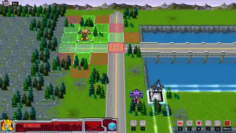
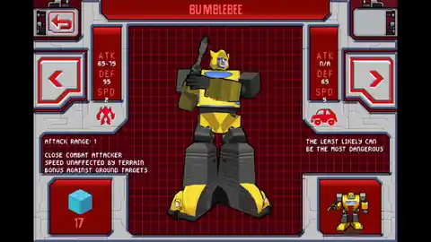
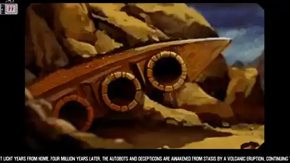

# Transformers G1 Awakening — PC

**A faithful desktop adaptation by iammrmikeman.**

G1 Awakening brings its original tactical campaign to PC, with desktop controls, high-resolution presentation, and numerous other improvements.

**Public release 1.0 · Windows x64 · Included executable build 1.0.1**

[Releases](https://github.com/iammrmikemanmods/G1-Awakening-PC/releases) · [Controls](docs/controls.md) · [Source and building](docs/building.md) · [Release notes](releases/v1.0/notes.md)

<!-- release-status:start -->
**1.0 download status: upload pending.** The complete game EXE and matching source are packaged; the release becomes downloadable once those files are attached and verified.
<!-- release-status:end -->

## Project status

**V0.17.0 is playable from beginning to end and the project is in its final polish stage.** The remaining work is polishing the PC experience, publishing the updated Windows build and matching source, and exploring future graphical improvements—not building the game from scratch.

The new publication is labelled **1.0**; the newly compiled executable retains its internal **1.0.1** build identity. Future graphical upgrades are separate from the established playable game.

## See the PC game

Three different views captured directly from the new Windows EXE running under Wine. No concept art or original-mobile reference images. Full-resolution PNGs are included in the Windows package.

### Plan your next move

### Inspect your units

### Follow the original story

## The PC experience

- The original tactical game and campaign, preserved for desktop play.
- Keyboard and mouse controls, with menu focus, tile selection, actions and camera movement.
- High-resolution widescreen rendering, 1080p/4K profiles, fullscreen and a resizable window.
- A modern opening and Classic/Enhanced texture selection.
- Further faithful visual improvements planned after the core release.

## Downloads and source

The prepared 1.0 package includes a newly compiled **G1Awakening.exe**, its required runtime files, matching source, checksums and screenshots of the actual PC game.

Once uploaded, Releases provides the standalone EXE, `G1_Awakening_PC_1.0_Windows.zip` and `G1_Awakening_PC_1.0_Source.zip`. The Windows ZIP includes the same complete EXE plus instructions and screenshots. The explicitly named source ZIP is the matching build snapshot; GitHub's automatically generated source archives are not a substitute for it. `G1OpeningPlayer.exe` is only a cinematic component, not the game.

Extract the Windows ZIP, launch **G1Awakening.exe**, choose 1080p or 4K, then select **Play**. No separate emulator installation is required. Saves and settings remain under `%LOCALAPPDATA%\G1Awakening`; keep a backup when changing versions.

The binary is unsigned. Verify the SHA-256 checksums rather than disabling Windows security. For a per-launch video fallback, use `G1Awakening.exe --play --1080p --windowed --no-intro`. Exact build and platform-check details are in [testing notes](docs/testing.md).

## Credits

PC adaptation, project direction and presentation: **iammrmikeman**. Original game and Transformers property belong to their respective creators and rights holders. Compatibility runtime: **touchHLE and its contributors**. This is an unofficial fan project, not an official Glu or Hasbro release. Third-party license notices remain attached to their code and binaries.
